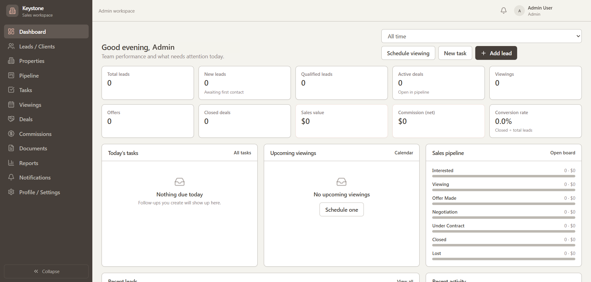
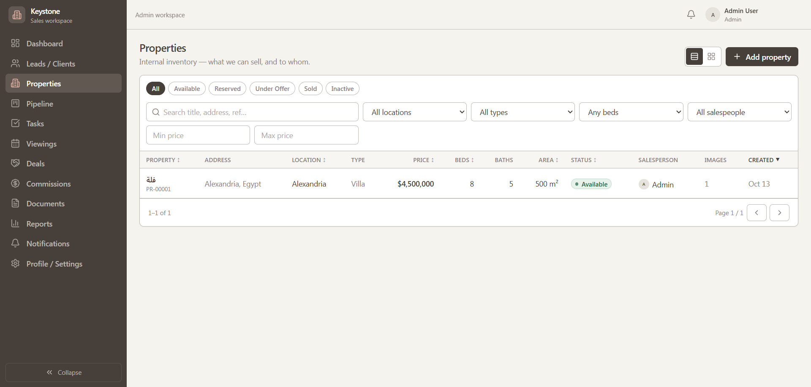
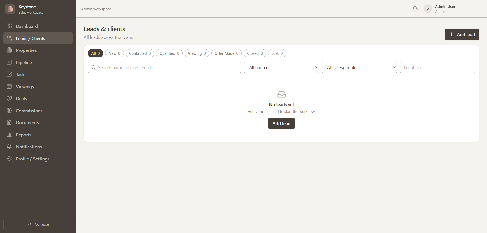
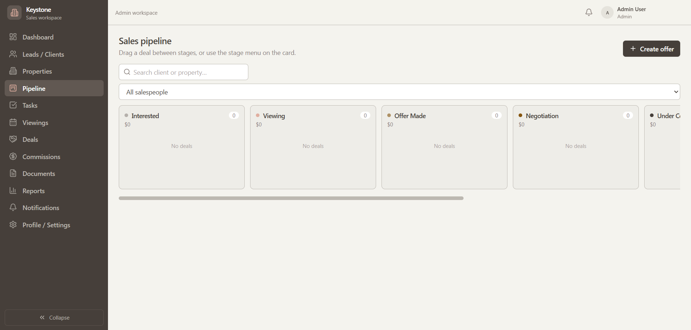

# Keystone
### Real Estate Sales CRM

A full-stack internal sales management platform designed to streamline real estate operations — from capturing leads and matching properties to scheduling viewings, managing deals, and tracking commissions.

Built with **Next.js, TypeScript, Django REST Framework, and PostgreSQL**, with an emphasis on modular architecture, role-based access control, and practical business workflows.

**Project Type:** Full-Stack Web Application  
**Status:** Portfolio Project — Development and deployment setup documented

---

## 01 / Overview

Real estate sales teams often manage customer information, property inventory, appointments, and deals across disconnected tools.

Keystone brings these workflows together in one internal workspace for salespeople, managers, and administrators.

The platform follows a connected sales lifecycle:

**Lead → Property Matching → Follow-up → Viewing → Offer → Deal → Commission**

Keystone is designed as an internal CRM, not a public property marketplace.

## 02 / Product Screenshots

A look at Keystone's application interface, including its dashboard, property inventory, lead management, and sales pipeline.

**Dashboard**



**Property Inventory**



**Leads & Clients**



**Sales Pipeline**



## 03 / Key Features

**Lead & Client Management**

Manage leads, track their status, assign salespeople, maintain notes, and review activity timelines.

**Property Management**

Maintain an internal property inventory, manage property information and images, and associate properties with interested leads.

**Sales Pipeline**

Track opportunities across stages including Interested, Viewing, Offer Made, Negotiation, Under Contract, Closed, and Lost.

**Tasks & Follow-ups**

Organize upcoming, overdue, and completed tasks, with follow-up workflows connected to sales activities.

**Viewing Management**

Schedule property viewings, identify scheduling conflicts, record feedback, and manage follow-up actions.

**Deals & Commissions**

Manage offers, deal progress, transaction documents, and commission calculations with approval workflows.

**Analytics & Notifications**

Provide role-aware dashboards, filtered sales reports, and in-app notifications.

**Role-Based Access Control**

Support three user roles:

| Role | Access |
|---|---|
| Salesperson | Assigned leads, tasks, viewings, deals, and personal performance |
| Manager | Team-wide sales operations, assignments, commissions, and analytics |
| Admin | User management, permissions, and administrative operations |

Data access restrictions are enforced by the backend API.

## 04 / Technology Stack

| Layer | Technologies |
|---|---|
| Frontend | Next.js 15, React, TypeScript, Tailwind CSS |
| Data Fetching | TanStack Query |
| Forms | React Hook Form |
| Backend | Python, Django 5, Django REST Framework |
| Authentication | JWT / SimpleJWT |
| Database | PostgreSQL |
| Development | Docker, Docker Compose |
| Deployment Architecture | Vercel, Neon PostgreSQL, containerized Django |

## 05 / System Architecture

The application separates frontend presentation, API business logic, and data persistence.

```text
Next.js Frontend
       |
       | HTTP / REST
       v
Django REST Framework
       |
       | Business Logic
       v
Domain Services & Permissions
       |
       v
PostgreSQL Database
```

The backend is organized into domain-specific Django applications, including leads, properties, tasks, viewings, deals, commissions, documents, notifications, and analytics.

Business rules are implemented in backend services rather than duplicated in frontend components.

The frontend uses reusable UI components, typed API integrations, and domain-specific features.

For further technical details, see [Architecture Documentation](docs/ARCHITECTURE.md).

## 06 / Project Structure

```text
real-estate-sales-crm/
├── backend/                 # Django REST API
├── frontend/                # Next.js application
├── docs/
│   ├── ARCHITECTURE.md
│   ├── DEPLOYMENT.md
│   └── screenshots/         # Product screenshots used in this README
├── docker-compose.yml
├── docker-compose.prod.yml
├── .env.example
└── README.md
```

## 07 / Running Locally

**Prerequisite:** Docker with Docker Compose.

Clone the repository:

```bash
git clone https://github.com/farhaghallab3/real-estate-sales-crm.git
cd real-estate-sales-crm
```

Create the environment configuration:

```bash
cp .env.example .env
```

Update the required environment variables with local development values.

Start the application:

```bash
docker compose up --build
```

Local services:

| Service | Address |
|---|---|
| Frontend | http://localhost:3000 |
| Backend API | http://localhost:8000/api/ |
| Django Admin | http://localhost:8000/django-admin/ |

For local development, demo data can be enabled using `SEED_DEMO_DATA=true`.

Demo credentials are configured through the environment, not hardcoded in this README.

## 08 / Engineering Considerations

- **Modular architecture:** Backend responsibilities are separated by business domain.
- **API-level permissions:** Access restrictions are applied server-side.
- **Business logic isolation:** Domain services handle business rules and workflows.
- **Typed frontend:** TypeScript supports consistent frontend integration.
- **Containerized development:** Docker Compose provides a reproducible local setup.
- **Extensible integrations:** The architecture provides extension points for additional notification channels and background processing.

**Authentication note:** The current implementation uses JWT access and refresh tokens stored in browser `localStorage`. A stricter production security model would use appropriately configured `httpOnly` cookies.

## 09 / Documentation

- [Architecture](docs/ARCHITECTURE.md)
- [Deployment Guide](docs/DEPLOYMENT.md)

The repository includes deployment configuration and documentation. Public demo availability and backend connectivity should be verified independently.

---

### Built for practical business workflows

Keystone demonstrates full-stack application development across frontend interfaces, REST APIs, database-backed workflows, role-based permissions, and deployment architecture.

**Developed by [Farha Ghallab](https://github.com/farhaghallab3)**

[Portfolio](https://farhaportofolio.vercel.app) · [LinkedIn](https://eg.linkedin.com/in/farhaghallab)
